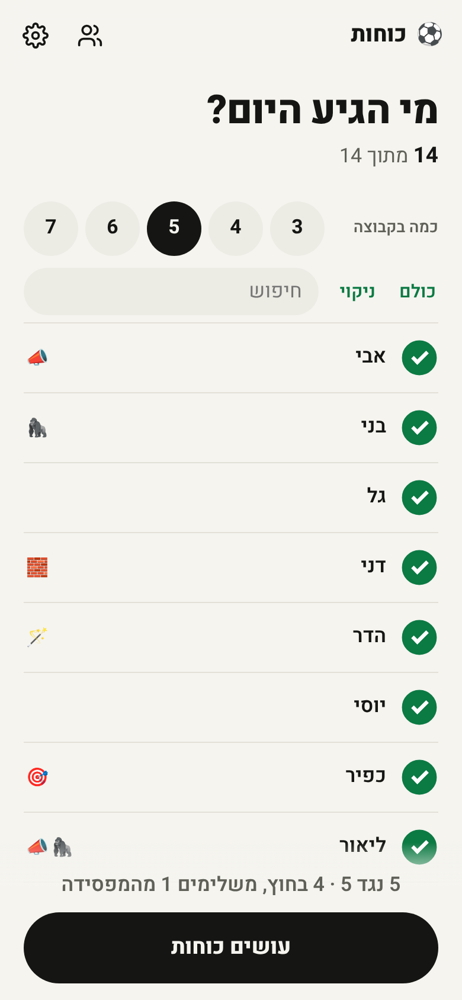
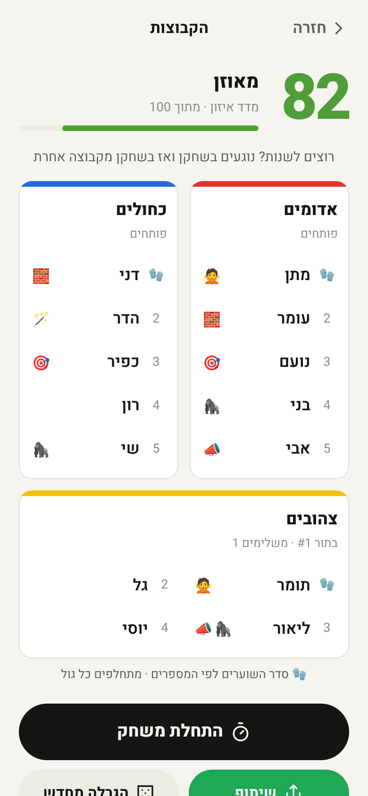
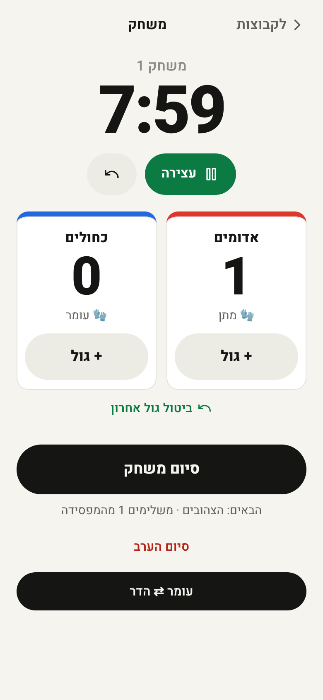
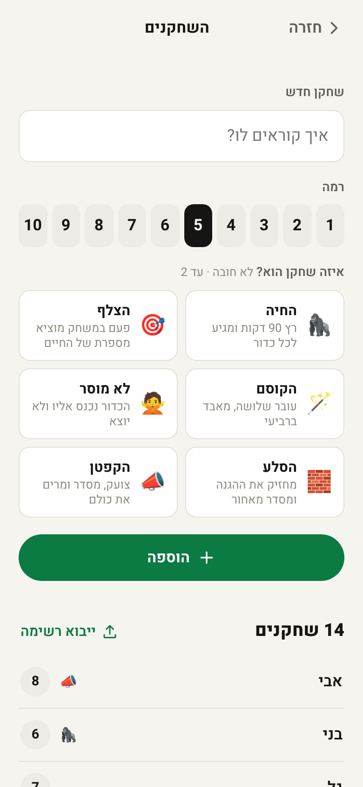

# כוחות (Kochot): fair teams for pickup football

Nobody wants to be the captain who picks teams. Kochot is a small, mobile-first web app in Hebrew
(RTL). You enter your friends once, tick who came tonight, and tap **עושים כוחות** ("make teams")
to get balanced teams. It then runs the whole "winner stays" evening: timer, goals, who comes on next,
and a nudge when one team keeps winning.

- No signup needed. Data stays on the phone (`localStorage`), with a backup file or link.
- **Groups:** keep separate rosters for each group you play with (the neighbourhood, the army base, the office).
- **Optional login** (Google, email code, or email + password) syncs a group between organizers' phones and lets you invite organizers with a link (Supabase).
- Installable to the home screen and works offline at the pitch (PWA).
- Static files only, so it can be hosted anywhere.

| Home | Teams | Match | Players |
|---|---|---|---|
|  |  |  |  |

## How it works for the group
1. **Players (once).** Each player needs a name and a level (1 = just started, 10 = the best in the
   group). Optionally, tap where he's strong: 🧤 טוב בשער (good in goal), 🛡️ הגנה (defence), 🔄 קישור (midfield),
   ⚡ התקפה (attack), as many as fit. The split spreads defenders, midfielders and attackers across the teams;
   🧤 means "one per team" in fixed-keeper mode; when keepers rotate everyone takes a turn in random order.
   Folded under **עוד על השחקן** ("more about the player") you can pick up to three player *cards*, in two rows:
   - **חוזקות (strengths):** 🦍 גורילה (big and physical), 🐆 צ'יטה (fast), 🎯 מדויק (accurate passing
     and shooting), 🪄 קוסם (dribbler), 🧠 מוח (vision), ⭐ כוכב (the captain type).
   - **חולשות (weaknesses):** 🫏 חמור (costly mistakes), 🦥 עצלן (lazy, doesn't track back), 🐢 איטי (slow),
     😮‍💨 נגמר אחרי 5 דקות (done after 5 minutes), 🙅 לא מוסר (doesn't pass), 🥶 מפחד מהכדור (afraid of the
     ball), 🌱 מתחיל (beginner).

   Cards shape the eight ratings used for balancing (stamina, passing, dribbling, shooting, defence,
   teamwork, leadership). Folded inside that, "דירוג מפורט מתקדם" (advanced detailed rating) opens one slider
   per rating, both when adding and when editing. You can also paste a whole list or upload a CSV ([template](docs/roster-template.csv)).
2. **Tonight.** Tick who came and choose players per team (3–7). The app explains the plan in one line:
   - 10 players, 5-a-side → `5 נגד 5` (5 vs 5)
   - 14 → `5 נגד 5 · 4 בחוץ, משלימים 1 מהמפסידה` (5 vs 5, 4 wait outside and borrow 1 from the losing team)
   - 11 → `5 נגד 5 · מחליף אחד` (5 vs 5, one sub)
   - 8 → `אין מספיק ל-5 בקבוצה, אז 4 נגד 4` (not enough for 5-a-side, so 4 vs 4)
3. **Teams.** You get numbered, colour-coded teams (or named after your bibs, if you have them) and the 0–100 balance score.
   - Every team gets a random **goalkeeper rotation**: 🧤 first, then 2, 3… Keepers swap every goal
     (or every 2–3 goals) conceded. A "fixed keeper" mode is available.
   - Tap two players to swap them. The score updates live.
   - **Late arrival:** they join the short team outside, or wait as a sub. Nobody else is reshuffled.
     If they complete the team outside, the app suggests one or two swaps and shows the score before and after.
   - Share to WhatsApp, re-roll, or copy. Individual ratings are never shown on this screen.
4. **Match night.**
   - A timer that keeps the screen on and vibrates and beeps when time is up.
   - **+ גול** ("+ goal") per team, with an optional scorer.
   - **סיום משחק** ("end match"): the loser goes to the back of the queue and the next team comes on.
     On a draw you pick who leaves; the default is the team that has been on longer.
   - Standings and top scorers for the evening.
   - **סיום הערב** ("end the evening") opens a summary: who won the night, top scorer, longest streak,
     biggest win, the table and every match. Past evenings and all-time leaders are under the clock icon
     on the main screen. An evening left open is saved automatically when the next game day starts.
   - If a team wins 3 in a row (or ≥ 75% after 4 games), the app suggests one swap to weaken it.
     It's a suggestion, never forced.

5. **Groups and sync.** Tap the group name under "כוחות" to switch groups, add one, or rename it.
   Without an account, groups live on the phone only. After logging in, **סנכרון בין טלפונים** puts the
   group in the cloud, and **הזמנת מארגן** shares an invite link (valid 14 days). Whoever opens it and logs in
   becomes an organizer, with full access including ratings. Edits merge between phones, and offline edits sync when the
   phone is back online. Tonight's attendance, teams and match stay on each phone.

**שאלות ותשובות** (the "?" in the top bar): short answers and a legend of every icon, generated from the cards and positions.

A new game day (12 h after the last activity) starts with an empty attendance list and offers
**כמו בפעם הקודמת** ("same as last time").

## Run it
```bash
npm install
npm run dev          # http://localhost:5173
npm test             # Vitest unit tests (engine, state, match, import, share)
npm run build        # type-check + production build into dist/
npm run preview      # serve dist/ on http://localhost:4173
```
Requires Node 18+ (developed on Node 22).

Login and sync use the Supabase project in `.env` (`VITE_SUPABASE_URL`, `VITE_SUPABASE_PUBLISHABLE_KEY`).
Remove those variables, and the app is local-only and hides login. The database schema and RLS are in
`supabase/migrations/`.

Browser checks against `npm run preview` (Playwright; set `CHROMIUM_PATH` if needed):
```bash
npm run screenshots -- ./screenshots   # 390px, light + dark; fails on console errors / overflow
npm run e2e                            # add, import, split 22, re-roll, late arrival, match, player rules, bibs on/off, end evening + summary + history, new day, backup link
npm run sounds-check                   # whistles/horn fire at the right moments (spies on Web Audio), never speech
npm run render-sounds -- ./sounds      # offline-render horn + whistles to WAV, check peak levels
node scripts/icons.mjs                 # regenerate PWA PNG icons from public/favicon.svg
```

## Importing a roster
One player per line: a name, then optionally the level, `שוער` or `טוב בשער` (good in goal), positions
(`הגנה`/`מגן`/`בלם`, `קישור`/`קשר`, `התקפה`/`חלוץ`/`כנף`) and card names
(any of the thirteen; `נגמר`, `לא חוזר` and `מפחד` also work as short forms, and the old names
like `החיה`, `הצלף`, `הקפטן` still work).
Commas, semicolons, tabs or spaces all work, and a header line is ignored:
```
שם,רמה,טוב בשער,עמדות,כרטיסיות
אבי,8,,קישור,כוכב
דני הקטן 6 שוער הגנה
נועם, 7, התקפה, קוסם, עצלן
יוסי
```
Duplicate names and levels outside 1–10 are skipped and listed. A backup `.json` file can be imported
from the same screen.

## Project layout
```
src/engine/   pure TypeScript: cost, search, team sizes (planFormat), swap suggestions + tests
src/match/    pure "winner stays" evening: clock, goals, queue, standings, dominance + tests
src/state/    model + v1→v2 migration, groups + storage migration, reducer, cards, late arrivals, import/backup, evening history + tests
src/worker/   Web Worker wrapper around the search (falls back inline)
src/sync/     groups sync: synced doc + 3-way merge, sync round, Supabase client (lazy), provider + tests
src/ui/       React screens: Home, Teams, Match, Players, Settings; groups and login sheets
supabase/     SQL migrations (tables, RLS, RPCs)
public/       manifest, icons, service worker, roster template
```

## Balancing
Each player is a vector of 8 ratings. For each attribute, the engine compares each team's
**per-player average** against the group average, weights the gaps (default: level × 3, others × 1)
and averages them. That is the *balance cost*, in rating points. Comparing averages rather than sums
equals padding a short team with one average player, which is exactly the "borrow from the losing team" rule.

Penalties keep rules near-hard:

| Rule | Penalty |
|---|---|
| A keep-together pair is split, or a keep-apart pair ends up together | 10 per pair |
| A team has no leader (leadership ≥ threshold) although there are enough | 1 per team |
| A team has no fixed keeper although there are enough (fixed mode only) | 2 per team |
| Team size differs from the plan | 50 per player |
| Positions bunched: per player a team is off its fair share of defenders / midfielders / attackers, beyond what's unavoidable (a two-position player counts ½ in each) | 0.15 per player |

**Search:**
- **2 teams with ≤ 14 players:** exhaustive. Player 0 is pinned when sizes are equal, so 14 players
  means 1,716 splits.
- **Otherwise:** local search. Restarts alternate between a noisy snake draft and random starts, each
  improved by swap hill-climbing, within about 250 ms. 22 players into 4 teams takes about 0.35 s in the browser.
- The best 40 distinct splits are kept for re-rolls. A re-roll picks a different split within
  `max(0.15, 40%)` of the best, never beyond +0.5, so it never breaks a rule.
- Substitutes are picked at random, preferring players without pair rules. They can be swapped in by tapping.
- **Late arrival:** at most two best-improvement swaps (`suggestSwaps`).
- **Dominance:** the swap that weakens the hot team while hurting overall balance the least (`suggestWeakeningSwap`).

**Score** = `round(100 · e^(−0.5 · cost))`. Well-balanced teams usually land at 80–95.

## Deploy
The app is hosted on **Vercel**. Step-by-step setup (Vercel, your own domain, Supabase redirect URLs,
the email code template and SMTP, Google login), in Hebrew: [docs/SETUP-HOSTING-AND-LOGIN.md](docs/SETUP-HOSTING-AND-LOGIN.md).

- `npm run build` outputs a static `dist/` with relative paths (`base: './'`), so any static host works.
- `vercel.json` sets the Vite preset and the headers: `index.html`, `sw.js` and the manifest are `no-cache`,
  hashed files in `assets/` are cached for a year (`immutable`), plus `nosniff`, `Referrer-Policy` and `X-Frame-Options`.
- No environment variables are needed on Vercel: the Supabase URL and publishable key come from the committed `.env`.
- The old GitHub Pages workflow (`.github/workflows/deploy.yml`, runs on `main` only) is superseded by Vercel.

The service worker precaches the app (not the lazy Supabase chunk), so the second visit works offline.
Every build stamps `sw.js` with a hash of the build, so a new deploy installs a new worker and drops the
old cache; pages are network-first, so users get the new version on the next open. It never caches Supabase calls.

For login on a new host, add its address to the Supabase redirect URLs (Authentication → URL Configuration).

## Privacy
- **Without an account, nothing leaves the phone**, unless you deliberately send a backup link or file.
  Both include ratings, and the app warns you about this. The app doesn't even contact the server.
- **When you log in and sync a group,** its roster goes to the Supabase project (EU, Frankfurt). That includes
  names, ratings, cards, pair rules, the group's settings and (when available) the evenings history.
  Your email is stored for the login.
  Row Level Security lets only that group's organizers read or change it. Invite links expire after 14 days.
- **Tonight's attendance, teams and match, and your theme/colour, are never uploaded.**
- The WhatsApp share text contains names only, plus the overall score.
